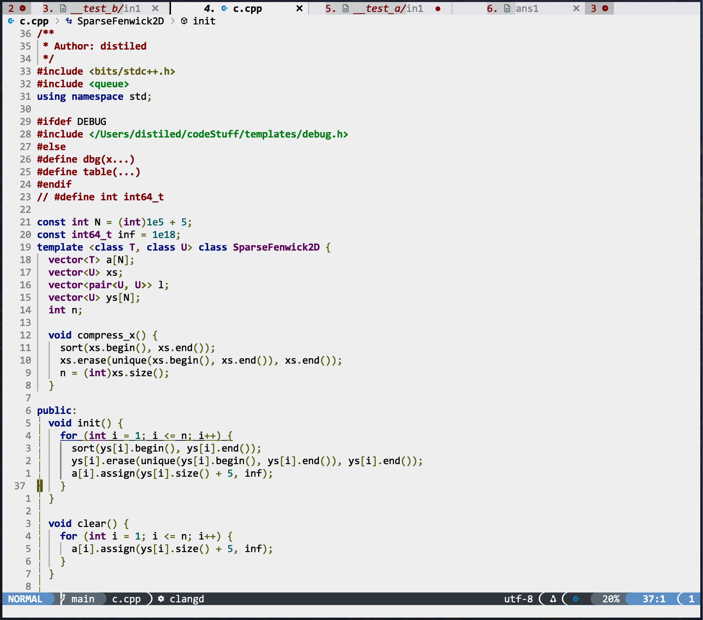

# codeforces.nvim

A light Neovim colorscheme that reproduces the Codeforces submission view
("→ Source" block) — the stock `prettify.css` palette rendered on
codeforces.com's light page.



| prettify class | token | hex (measured) |
| --- | --- | --- |
| `.pln` | plain text | `#000000` |
| `.kwd` | keywords, `int`/`long`/`bool`/... | `#000d86` |
| `.str` | strings | `#038716` |
| `.com` | comments, `#include`/`#define` lines | `#890003` |
| `.typ` | `vector`, CamelCase types, `foo_t` | `#660464` |
| `.lit` | numbers | `#006666` |
| `.pun` | punctuation / operators | `#67650f` |

Background is `#eff0f1`, the rendered shade of CF's source panel.

## Install

[lazy.nvim](https://lazy.folke.io):

```lua
{
  "bibimoni/codeforces.nvim",
  lazy = false, -- keep on rtp so the C++ query overrides always apply
  priority = 1000,
}
```

then

```vim
:colorscheme codeforces
```

or apply it in the spec:

```lua
{
  "bibimoni/codeforces.nvim",
  lazy = false,
  priority = 1000,
  config = function()
    vim.cmd.colorscheme("codeforces")
  end,
}
```

## What ships

- `colors/codeforces.lua` — the colorscheme (UI, legacy syntax, treesitter,
  LSP semantic-token groups).
- `after/queries/cpp/highlights.scm` — treesitter query extends for C++ that
  replicate prettify's actual C++ lexing, not the "obvious" treesitter
  mapping. Highlights, derived by running prettify's real lexer:

  - `int`/`float`/`uint64_t`/... are **purple** (`.typ`); `short`, `long`,
    `char`, `bool`, `void`, `double` are **navy** (`.kwd`).
  - `pair`, `tuple`, `deque`, `string`, `greater`, `function`, `list` render
    plain black (prettify's `C_TYPES` regex omits them).
  - Lower-case typedef aliases (`ll`, `vi`, ...) render plain black;
    CamelCase and `*_t` stay purple.
  - `#define MAXN 200005`: the name stays black, the value is teal.
  - `static_cast<T>` is a navy keyword, not a function.
  - `vector<int>(n, 1)` constructor calls keep the type purple.
  - `#include <bits/stdc++.h>` is olive punctuation (prettify's stdio
    regex rejects `++` in the name, so CF doesn't paint it green).

Both files are comment-heavy on purpose: every deviation from the obvious
mapping was verified against a rendered codeforces.com submission page.

## Requirements

- Neovim ≥ 0.9 (uses `vim.api.nvim_set_hl`, treesitter capture groups).
- `vim.o.termguicolors = true` (the colorscheme sets it).
- The C++ query overrides apply when treesitter highlighting is enabled
  (e.g. `:TSInstall cpp` + `vim.treesitter.start()` / nvim-treesitter
  highlight module).
